  

  

## What I do

I explore how people learn and how systems can help them: educational materials,
AI/ML experiments, and simulations that make abstract ideas tangible.

- **Education** — courses, problem books, and explanations that respect the reader.
- **AI/ML** — local-first tools and research utilities.
- **Simulation** — small worlds where rules are visible and ideas can be tested.

## Selected work

### Education

- **[YouTube PyTorch Lessons](https://github.com/magorokhoov/youtube_pytorch_lessons)** — notes and code from my PyTorch video lessons; learning by building.
- **[Physics Quest Book](https://github.com/magorokhoov/Physics-Quest-Book)** — a question book for school physics, from concepts to problems.
- **[Problems for Math Clubs](https://github.com/magorokhoov/problems-for-math-clubs)** — a problem book for math circles, available as a PDF.

### AI / ML

- **[Whisper Notepad](https://github.com/magorokhoov/whisper-notepad)** — offline speech-to-text notepad that runs locally on CPU.
- **[toolbox4nn](https://github.com/magorokhoov/toolbox4nn)** — utilities for PyTorch research and experiments.

### Simulations

- **[SimPhysX](https://github.com/magorokhoov/SimPhysX)** — a small simulator of physical processes.
- **[CellsInBox](https://github.com/magorokhoov/CellsInBox)** — artificial life in a box: simple agents, mutation, and evolution.

## Currently

- Building learning tools that work without a cloud account.
- Exploring small models that run on ordinary hardware.
- Using simulations as explanations, not just demonstrations.

<i>Learning by building. Teaching by showing.</i>

